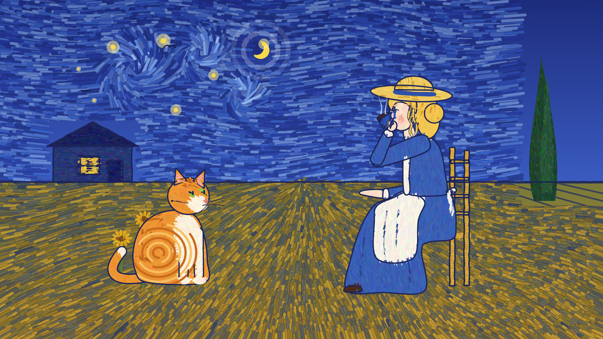
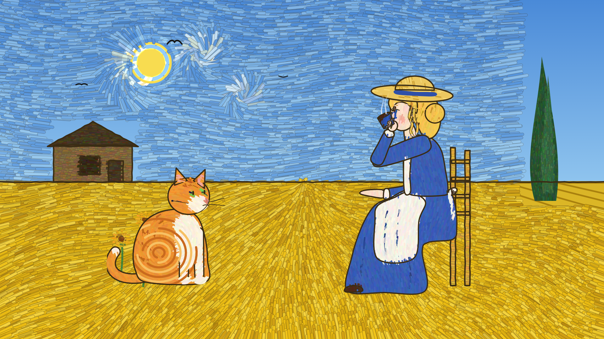
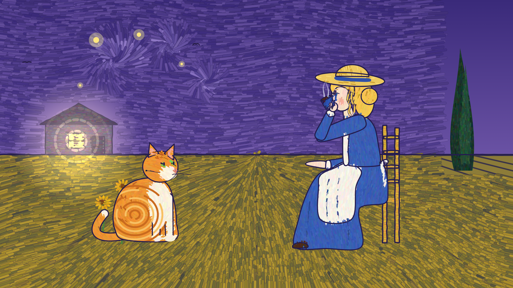

# van-gogh-night-wheatfield · 1889 星夜麦田

一支**纯代码绘制**的梵高风格动画：没有一帧是 AI 生图——星空漩涡、麦浪、少女、橘猫、乌鸦全部由 Canvas 程序化绘制，逐像素确定性渲染（同一种子两次渲染结果一致）。



- 成片：[`成片_梵高夜麦田.mp4`](成片_梵高夜麦田.mp4)（9.5 秒 · 60fps · 1080p，右上角 1889 年份角标）
- **画是活的**：乌鸦横穿天空（主动作）；漩涡旋转、麦浪起伏、星星闪烁、月亮光晕脉动、少女喝茶热气卷曲（母题循环）
- **数字验收**：`qa.py` 运动量 2.42%、静止帧对 0%、跳变仅开场揭幕、确定性 ✓；另派独立 agent 只看抽帧审片通过

## 同一构图的三个方向

| A 夜·星月夜（采用） | B 昼·麦田群鸦 | C 暮·灯下麦田 |
|---|---|---|
|  |  |  |

同一帧先出三个方向再动工，是 [kuige-art-motion](https://github.com/Tliens/kuige-art-motion) skill 的「三方向硬门」。三个方向共用构图与角色，只换色板、日月、乌鸦数与波浪幅度；B/C 的代码已就绪，`代码工程/scenes/vg_a.js` 一个文件注册 `vg_a / vg_b / vg_c`。

## 重新渲染

依赖 [uv](https://docs.astral.sh/uv/)、ffmpeg、Playwright Chromium（首次 `uv run --with playwright playwright install chromium`）：

```sh
cd 代码工程
uv run --with playwright python render.py --solo vg_a --from 0 --to 9.5 --fps 60 --out ../成片.mp4
# 换方向：--solo vg_b / vg_c；静帧：加 --stills 2.5 --no-counter --out 目录
```

验收：

```sh
uv run --with playwright --with numpy --with pillow python <skill>/scripts/qa.py --project . --ids vg_a
```

## 来源与致谢

- 用 [Tliens/kuige-art-motion](https://github.com/Tliens/kuige-art-motion) skill 制作；它 fork 自 [alchaincyf/huashu-art-motion](https://github.com/alchaincyf/huashu-art-motion)（© 花叔，MIT）。引擎、角色骨架（RIG.girl/cat）与标杆场景 `09_postimp` 的管线来自上游，本仓库的场景 `vg_a.js` 在其管线上新写。
- 构图参考《星月夜》《麦田群鸦》的公共领域风格特征（漩涡天空、丝柏、乌鸦、铬黄麦田），未复制任何原画像素。
- `代码工程/lib/fonts/` 为 SIL OFL 开源字体，清单见目录内 `LICENSES.md`。

## 许可证

MIT。
